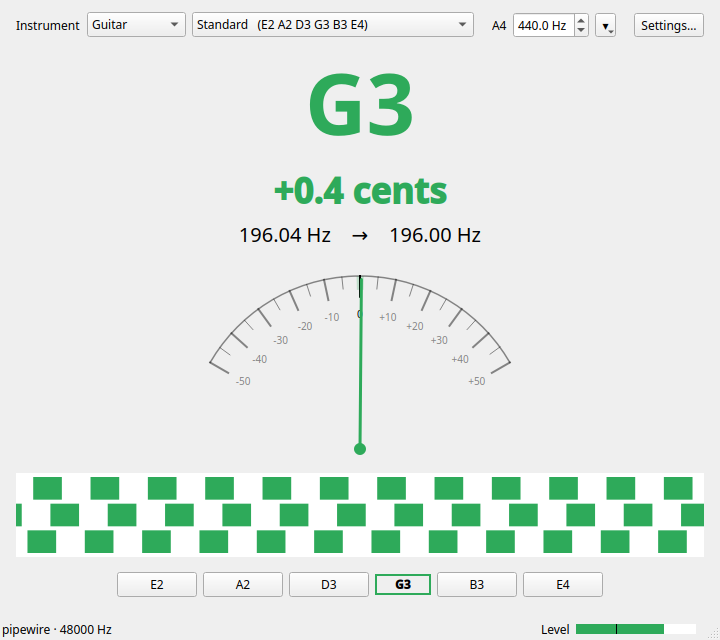

py-tuner
========

*Leer en español: [README_es.md](README_es.md).*

An accurate tuner for guitar, bass, double bass and violin, with a
chromatic mode for anything else. It shows a needle and a strobe, and it
runs in a window, in a full-screen terminal or as a single line on the
command line, in English or Spanish.

On a steady string, a single analysis frame is within a few hundredths of a
cent of the true pitch; with noise 20 dB below the signal, the reading shown
(which averages half a second) still stays within about a tenth of a cent.
The fundamental is found from all the harmonics of the string, with their
inharmonicity, so it works even when a small microphone hardly picks up the
fundamental of a low string.

What it does
------------

- Guitar, bass, double bass and violin, with their usual tunings and
  others (Drop D, DADGAD and the open tunings; the five- and six-string
  bass; the solo tuning and the low B and C of the double bass; two
  scordature of the violin), and a chromatic mode. Your own tunings can be
  added in the settings.
- The string compared against is the nearest one, or one you lock.
- The reference A, from 380 to 480 Hz, in tenths of a hertz, with a menu
  of the usual ones (415, 432, 440, 442, 443 Hz...).
- A needle with the in-tune zone in green, a strobe of three bands that
  move at one, two and four times the deviation, or both.
- Note names in English, Latin (Do Re Mi) or German (with H and B), with
  sharps, flats or both (F♯/G♭).
- `py-tuner cli --file recording.wav` measures a WAV recording note by note.

Installing
----------

Each release, on [GitHub](https://github.com/nivaca/py-tuner/releases) and
[Codeberg](https://codeberg.org/nivaca/py-tuner/releases), has:

- **Fedora**: an RPM, also in Copr, so that `dnf upgrade` brings each new
  version:

      sudo dnf copr enable nivaca/py-tuner
      sudo dnf install py-tuner

- **Any Linux** with glibc 2.34 or later (Ubuntu 22.04, Debian 12, Fedora
  35 and later): an AppImage, which carries its own Python, Qt and
  PortAudio and needs no installing:

      chmod +x py-tuner-VERSION-x86_64.AppImage
      ./py-tuner-VERSION-x86_64.AppImage          # the window
      ./py-tuner-VERSION-x86_64.AppImage tui      # the terminal

- The wheel and the source, for installing with pip (`pip install
  py_tuner-VERSION-py3-none-any.whl`), which needs PortAudio from the
  system (`sudo dnf install portaudio`, `sudo apt install libportaudio2`).

Every file is signed with the key in `packaging/RPM-GPG-KEY-py-tuner`
(`FILE.asc`, and `SHA256SUMS` with its signature): `gpg --import
RPM-GPG-KEY-py-tuner`, then `gpg --verify FILE.asc FILE`.

To run it from the source, with Python 3.14 or later and
[uv](https://docs.astral.sh/uv/):

    uv run py-tuner

Using it
--------

    py-tuner              # the window
    py-tuner tui          # the terminal
    py-tuner cli          # one line of text
    py-tuner devices      # list the inputs
    py-tuner instruments  # list the instruments and tunings

Common options, for all three:

    -a, --a4 HZ          reference A4, 380 to 480 Hz (default 440)
    -i, --instrument     chromatic (default), guitar, bass, double-bass or violin
    -t, --tuning NAME    e.g. "Drop D", "5-string", "Solo"
    -s, --string N|auto  tune against string N (1 = the lowest) only
    --names              english, latin (Do Re Mi) or german (H, B)
    --accidentals        sharps, flats or both (F#/Gb); also --flats, --sharps
    -d, --device DEV     input device, by number or part of its name
    -f, --file WAV       read a WAV file instead of the sound card
    --language en|es     the language of the interface
    --save               keep the options given as the new settings

`py-tuner cli --file recording.wav` analyses a recording at once and prints
one line for each note heard in it, with its frequency and its deviation in
cents. `py-tuner cli --once` waits for the first steady reading, prints it
and exits.

In the terminal, the arrow keys change A4 (left and right by 0.1 Hz, up and
down by 1 Hz), `0` puts it back to 440, `i` changes the instrument, `t` the
tuning, `s` locks a string, `n` the note names, `b` sharps, flats or both, `v` the
view, `l` the language, and `q` quits. In the window, a click on a string
button locks that string, and a second click unlocks it.

Documentation
-------------

- The user manual: [docs/MANUAL_en.pdf](docs/MANUAL_en.pdf) (in Spanish,
  [docs/MANUAL_es.pdf](docs/MANUAL_es.pdf)); `man py-tuner` once the RPM
  is installed.
- How it was made: [docs/DESCRIPTION.md](docs/DESCRIPTION.md).
- The open-source software it uses, with its licences:
  [docs/THIRD-PARTY.md](docs/THIRD-PARTY.md).
- The changes of each version: [CHANGELOG.md](CHANGELOG.md).

Settings
--------

The settings are kept in `~/.config/py-tuner/settings.json` (or under
`$XDG_CONFIG_HOME`), the same for the window, the terminal and the command
line, and every change made in the window or the terminal is saved there at
once. Besides the ones above: `tolerance` (cents within which a note counts
as in tune, default 1), `min_level` (sounds quieter than this, in dBFS, are
ignored), `smoothing` (seconds the reading averages) and `periods` (the
length of each analysis frame, in periods of the note: more is steadier,
fewer reacts faster). Your own tunings go in `custom_tunings`:

    "custom_tunings": [
      {"instrument": "guitar", "name": "Nashville", "strings": "E3 A3 D4 G4 B3 E4"}
    ]

Development
-----------

    uv run python tools/test.py

runs the tests, each file in a process of its own, all at once. How a
release is made is told in [packaging/COPR.org](packaging/COPR.org).

License
-------

py-tuner is free software, under the GNU General Public License, version 3
or later (see [LICENSE](LICENSE)). Author: Nicolas Vaughan
<nicolasvaughan@proton.me>.
