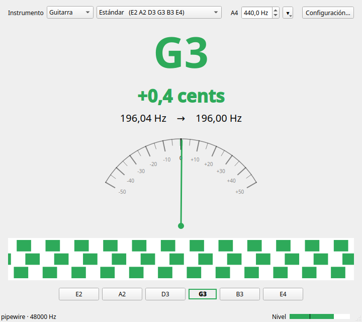
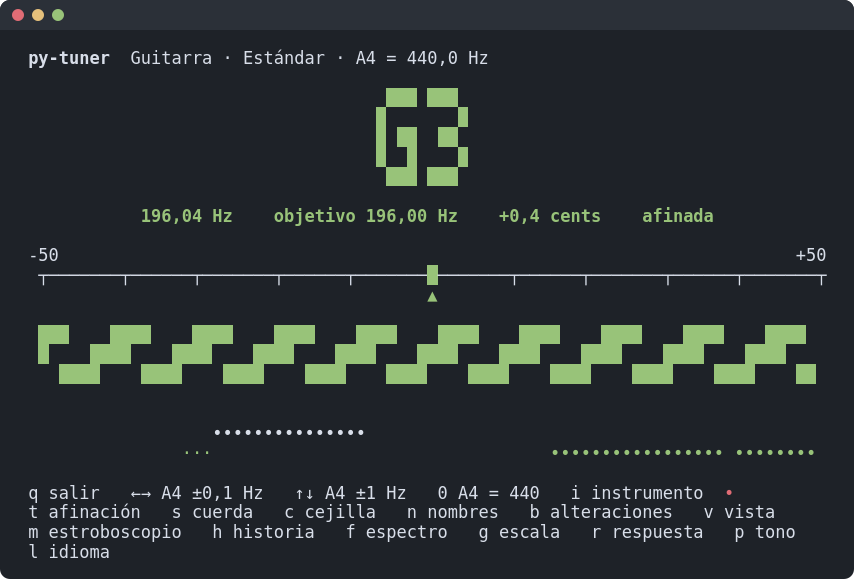
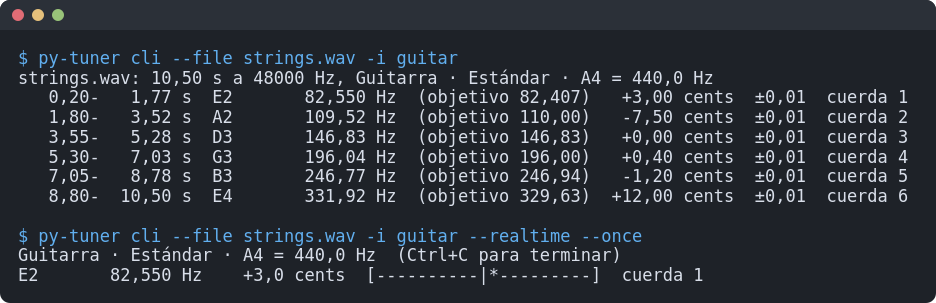

py-tuner
========

*Read in English: [README.md](README.md).*

Un afinador preciso para guitarra, bajo, contrabajo y violín, con un modo
cromático para cualquier otro instrumento. Muestra una aguja y un
estroboscopio, y funciona en una ventana, en la terminal a pantalla
completa o como una sola línea en la línea de órdenes, en español o en
inglés.

En una cuerda estable, cada cuadro de análisis cae a unas centésimas de
cent de la altura verdadera; con ruido 20 dB por debajo de la señal, la
lectura que se muestra (que promedia medio segundo) sigue a una décima de
cent, más o menos. La fundamental sale de todos los armónicos de la cuerda,
con su inarmonicidad, así que funciona aunque un micrófono pequeño apenas
recoja la fundamental de una cuerda grave; y distingue la nota verdadera de
su octava, de su duodécima y del golpe de la pulsación: en once grabaciones
reales de guitarra quedó una nota falsa donde había quince.

Lo que hace
-----------

- Guitarra, bajo, contrabajo y violín, con sus afinaciones habituales y
  otras (Drop D, DADGAD y las abiertas; el bajo de cinco y de seis
  cuerdas; la afinación solista y el Si y el Do graves del contrabajo; dos
  scordature del violín), y un modo cromático. Se pueden añadir afinaciones
  propias en la configuración.
- La cuerda de comparación es la más cercana, o una que se fije.
- El La de referencia, de 380 a 480 Hz, en décimas de hercio, con un menú
  de los habituales (415, 432, 440, 442, 443 Hz...).
- Una aguja con la zona afinada en verde, un estroboscopio de verdad, o los
  dos. Cada banda del estroboscopio sigue la fase de una parcial de la
  cuerda: en modo vernier, la parcial más clara a una, dos y cuatro veces la
  velocidad; en modo de armónicos, las parciales 1, 2 y 3, cada una donde la
  pone la inarmonicidad de la cuerda.
- La historia de la desviación en los últimos segundos, y el espectro con
  sus picos más claros nombrados.
- La aguja en una escala lineal o en una fina, donde los últimos cents se
  abren.
- Una respuesta estable para el contrabajo, cuya altura se mueve mientras
  suena: sin el ataque de cada pulsación, con un promedio más largo y una
  aguja más lenta.
- Se ignoran los sonidos que no sobresalen 10 dB del ruido del cuarto,
  aprendido mientras no suena nada.
- Desviaciones de unos cents para cualquier nota, los nombres transpuestos
  para un instrumento transpositor, una cejilla y un tono de referencia.
- Nombres de las notas en inglés, latinos (Do Re Mi) o alemanes (con H y
  B), con sostenidos, bemoles o ambos (F♯/G♭).
- `py-tuner cli --file grabación.wav` mide una grabación WAV nota por nota.

Instalación
-----------

Cada versión, en [GitHub](https://github.com/nivaca/py-tuner/releases) y en
[Codeberg](https://codeberg.org/nivaca/py-tuner/releases), trae:

- **Fedora**: un RPM, también en Copr, para que `dnf upgrade` traiga cada
  versión nueva:

      sudo dnf copr enable nivaca/py-tuner
      sudo dnf install py-tuner

- **Cualquier Linux** con glibc 2.34 o posterior (Ubuntu 22.04, Debian 12,
  Fedora 35 y posteriores): una AppImage, que lleva su propio Python, Qt y
  PortAudio y no hay que instalar:

      chmod +x py-tuner-VERSIÓN-x86_64.AppImage
      ./py-tuner-VERSIÓN-x86_64.AppImage          # la ventana
      ./py-tuner-VERSIÓN-x86_64.AppImage tui      # la terminal

- El wheel y el código, para instalarlo con pip (`pip install
  py_tuner-VERSIÓN-py3-none-any.whl`), que necesita la PortAudio del
  sistema (`sudo dnf install portaudio`, `sudo apt install libportaudio2`).

Cada archivo va firmado con la clave de `packaging/RPM-GPG-KEY-py-tuner`
(`ARCHIVO.asc`, y `SHA256SUMS` con su firma): `gpg --import
RPM-GPG-KEY-py-tuner` y después `gpg --verify ARCHIVO.asc ARCHIVO`.

Para correrlo desde el código, con Python 3.14 o posterior y
[uv](https://docs.astral.sh/uv/):

    uv run py-tuner

Uso
---

    py-tuner              # la ventana
    py-tuner tui          # la terminal
    py-tuner cli          # una línea de texto
    py-tuner tone E2      # tocar una nota de referencia (o una cuerda: -i guitar tone 1)
    py-tuner devices      # las entradas de sonido
    py-tuner instruments  # los instrumentos y sus afinaciones

Las opciones comunes, para los tres:

    -a, --a4 HZ          el La de referencia, de 380 a 480 Hz (440 por omisión)
    -i, --instrument     chromatic (por omisión), guitar, bass, double-bass o violin
    -t, --tuning NOMBRE  p. ej. "Drop D", "5 cuerdas", "Solista"
    -s, --string N|auto  afinar solo contra la cuerda N (1 = la más grave)
    --names              english, latin (Do Re Mi) o german (H, B)
    --accidentals        sharps, flats o both: sostenidos, bemoles o ambos (F#/Gb); también --flats, --sharps
    --offset NOTA=CENTS  afinar una nota fuera del temperamento igual, p. ej. B=-2
    --transpose N        nombres para un instrumento transpositor (2 para si bemol)
    --capo TRASTE        una cejilla, que sube todas las cuerdas
    --strobe MODO        vernier o harmonics
    --trace, --no-trace  la historia de la desviación
    --spectrum           el espectro, con sus picos nombrados
    --needle ESCALA      la escala de la aguja: linear (lineal) o fine (fina)
    --no-learn-noise     solo el nivel fijo, no el ruido aprendido del cuarto
    -d, --device DISP    el dispositivo de entrada, por su número o parte de su nombre
    -f, --file WAV       leer un archivo WAV en lugar de la tarjeta de sonido
    --language en|es     el idioma de la interfaz
    --save               guardar las opciones dadas como la nueva configuración

`py-tuner cli --file grabación.wav` analiza una grabación de una vez y
escribe una línea por cada nota que suena en ella, con su frecuencia y su
desviación en cents. `py-tuner cli --once` espera la primera lectura
estable, la escribe y termina.

En la terminal, las flechas cambian el La (izquierda y derecha, 0,1 Hz;
arriba y abajo, 1 Hz), `0` lo devuelve a 440, `i` cambia el instrumento,
`t` la afinación, `s` fija una cuerda, `c` mueve la cejilla, `n` los
nombres de las notas, `b` sostenidos, bemoles o ambos, `v` la vista, `m` el
modo del estroboscopio, `h` la historia, `f` el espectro, `g` la escala de
la aguja, `p` toca el tono de referencia, `l`
el idioma, y `q` sale. En la ventana, un clic en el botón de una cuerda la
fija, y otro la suelta; el botón Tono toca la cuerda fija, o la nota que se
muestra.

Documentación
-------------

- El manual de usuario: [docs/MANUAL_es.pdf](docs/MANUAL_es.pdf) (en
  inglés, [docs/MANUAL_en.pdf](docs/MANUAL_en.pdf)); `man py-tuner` una vez
  instalado el RPM.
- Cómo se hizo: [docs/DESCRIPCIÓN_es.md](docs/DESCRIPCIÓN_es.md).
- El software de código abierto que usa, con sus licencias:
  [docs/TERCEROS_es.md](docs/TERCEROS_es.md).
- Los cambios de cada versión: [CHANGELOG_es.md](CHANGELOG_es.md).

Configuración
-------------

La configuración se guarda en `~/.config/py-tuner/settings.json` (o bajo
`$XDG_CONFIG_HOME`), la misma para la ventana, la terminal y la línea de
órdenes, y cada cambio hecho en la ventana o en la terminal se guarda ahí en
el acto. Además de lo dicho: `tolerance` (los cents dentro de los cuales una
nota está afinada, 1 por omisión), `min_level` (los sonidos más débiles que
esto, en dBFS, se ignoran), `smoothing` (los segundos que promedia la
lectura), `periods` (la longitud de cada cuadro de análisis, en períodos de
la nota: más es más estable, menos reacciona más rápido) y `response`
(`normal`, o `steady`, estable, para el contrabajo). Las afinaciones
propias van en `custom_tunings`:

    "custom_tunings": [
      {"instrument": "guitar", "name": "Nashville", "strings": "E3 A3 D4 G4 B3 E4"}
    ]

Desarrollo
----------

    uv run python tools/test.py

corre las pruebas, cada archivo en un proceso propio, todos a la vez. Cómo
se publica una versión está en [packaging/COPR.org](packaging/COPR.org).

Licencia
--------

py-tuner es software libre, bajo la Licencia Pública General de GNU, versión
3 o posterior (véase [LICENSE](LICENSE)). Autor: Nicolas Vaughan
<nicolasvaughan@proton.me>.
